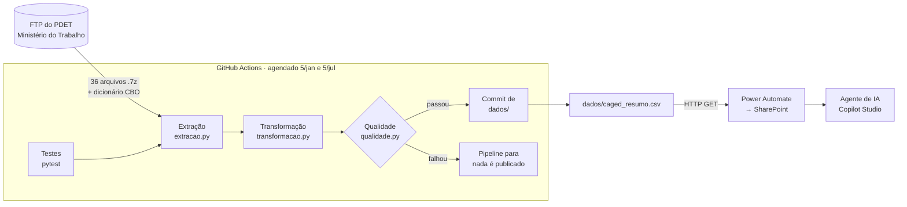

# Pipeline do Novo CAGED: emprego e salário por profissão

[](https://github.com/iangago/brasas-caged-pipeline/actions/workflows/pipeline.yml)

Pipeline de dados que transforma os microdados oficiais de emprego formal do Brasil (**~52 milhões de registros por ano**) em uma tabela de **2.671 profissões** com crescimento e salário de admissão. Roda sozinho no GitHub Actions a cada semestre e alimenta um agente de IA usado por um cliente real.

## Contexto

Projeto do programa RISE (UniCarioca + adaQuest) para o **Brasas**, escola de inglês que vende cursos online de inglês por profissão ("Inglês para recepcionista de hotel", por exemplo). Um agente de IA no Microsoft Copilot Studio recomenda quais cursos criar, cruzando vagas que pedem inglês com dois sinais de mercado que vêm deste pipeline:

| Critério do agente | Pergunta | Coluna |
| --- | --- | --- |
| **Crescimento** | Essa profissão está contratando mais do que demitindo? | `saldo`, `taxa_saldo` |
| **Poder de compra** | Quem entra nessa profissão consegue pagar um curso de R$ 700? | `salario_mediano_admissao` |

## O problema

O Novo CAGED (Ministério do Trabalho) é a fonte oficial de admissões e desligamentos com carteira assinada, mas **não tem API**:

- os dados ficam num **FTP do governo**, em arquivos `.7z` mensais de ~50 MB (~450 MB descompactado);
- cada mês tem **~4,3 milhões de linhas** e 28 colunas;
- cada mês vem em **3 arquivos** que precisam ser combinados (no prazo, fora do prazo e exclusões).

Nada disso cabe numa ferramenta low-code como o Copilot Studio, que não abre `.7z`, cobra por ação executada e não acessa a internet a partir do interpretador de código. Por isso o processamento pesado roda aqui, e o agente só lê o resultado: um CSV de ~500 KB.

## Arquitetura



| Etapa | O que faz |
| --- | --- |
| **Extração** | Descobre sozinha os 12 meses mais recentes publicados (o CAGED sai com ~2 meses de atraso), baixa os arquivos MOV, FOR e EXC de cada mês e o dicionário oficial de ocupações. |
| **Transformação** | Lê só 5 das 28 colunas, limpa os tipos, filtra a janela de 12 meses e agrega por ocupação: 52 milhões de linhas viram 2.671. |
| **Qualidade** | Barra a publicação se faltar mês, coluna ou ocupação, se aparecer contagem negativa ou se houver CBO fora do padrão. Gera um relatório a cada rodada. |
| **Carga** | O próprio Action faz commit do CSV e do relatório. O histórico do git vira o versionamento dos dados. |

Uma rodada completa leva **~14 minutos** e custa zero (GitHub Actions gratuito para repositório público).

## Decisões de modelagem

**1. Saldo = MOV + FOR − EXC, pelo mês em que a movimentação aconteceu.**
Cada mês publicado traz as movimentações declaradas no prazo (MOV), as atrasadas, que se referem a meses anteriores (FOR), e as exclusões de declarações erradas (EXC). Somar só o MOV dá o número errado. O pipeline soma tudo agrupando pela `competênciamov` (quando o fato aconteceu), não pelo mês da declaração. Uma exclusão entra com sinal invertido: excluir uma admissão reduz o saldo. A regra segue o *Leia-me* oficial do PDET.

**2. Janela de 12 meses.**
Emprego é sazonal: só dezembro de 2025 teve saldo de **−635 mil**, e fevereiro de 2026 teve **+268 mil**. Com 12 meses, nenhuma profissão parece em alta só por estar na sua época do ano.

**3. Mediana, não média, para o salário.**
Os dados têm salários digitados errado (R$ 27,8 milhões numa admissão) e dezenas de milhares de zeros. A média de um mês dava R$ 2.600 e a mediana R$ 2.005. A mediana não é afetada por esses extremos.

**4. Quais salários entram.**
Pelo dicionário oficial, a coluna `salário` já é o **salário mensal declarado** (a remuneração por hora ou dia fica em `valorsaláriofixo`). Entram admissões com salário > 0 e unidade de pagamento hora, dia, semana, quinzena ou mês. Saem tarefa, variável e não identificado: no teste, a mediana dessas unidades era R$ 9,51 e R$ 0. A coluna `n_salarios` mostra quantos salários sustentam cada mediana.

**5. Crescimento relativo, não absoluto.**
O saldo absoluto sempre favorece profissões enormes (o saldo de "faxineiro" é maior que o de quase qualquer outra). `taxa_saldo = saldo ÷ admissões` mede o crescimento proporcional ao tamanho da profissão.

**6. Uma única fonte.**
Os nomes das ocupações vêm da planilha de layout publicada no mesmo FTP. Dado e dicionário saem da mesma fonte e da mesma versão.

## Saída

`dados/caged_resumo.csv`, uma linha por ocupação da CBO 2002:

| Coluna | Descrição |
| --- | --- |
| `cbo_ocupacao` | Código da ocupação (CBO 2002, 6 dígitos) |
| `nome_ocupacao` | Nome oficial da ocupação |
| `admissoes`, `desligamentos`, `saldo` | Totais da janela, já com MOV + FOR − EXC |
| `taxa_saldo` | Saldo ÷ admissões |
| `salario_mediano_admissao` | Mediana do salário mensal de admissão (R$) |
| `n_salarios` | Quantos salários entraram na mediana |
| `periodo_inicio`, `periodo_fim` | Janela coberta (AAAAMM) |
| `recorte`, `fonte`, `data_processamento` | Rastreabilidade |

Exemplo (janela out/2025 a set/2026):

| Ocupação | Admissões | Saldo | Taxa | Salário mediano |
| --- | ---: | ---: | ---: | ---: |
| Recepcionista, em geral | 389.513 | +41.969 | 10,8% | R$ 1.800 |
| Recepcionista de hotel | 31.354 | +1.696 | 5,4% | R$ 1.944 |
| Técnico de apoio ao usuário de informática (helpdesk) | 40.788 | +8.342 | 20,5% | R$ 2.190 |
| Analista de desenvolvimento de sistemas | 69.306 | +3.370 | 4,9% | R$ 7.430 |
| Contador | 40.254 | −4.181 | −10,4% | R$ 4.442 |

O [`relatorio_qualidade.md`](dados/relatorio_qualidade.md) mostra o saldo Brasil mês a mês para conferência com os números divulgados pelo Ministério.

## Qualidade e testes

- **Testes (pytest)** cobrem as regras de negócio com dados pequenos e conhecidos: uma exclusão desfaz uma admissão, o outlier de R$ 27 milhões não mexe na mediana, o CBO recupera o zero à esquerda e uma coluna ausente gera erro. Rodam em todo push e antes de toda execução do pipeline.
- **Validações em produção** fazem o pipeline falhar em vez de publicar dado errado (ver `caged_pipeline/qualidade.py`).
- **Leitura robusta:** colunas encontradas pelo nome sem acento, para não quebrar se o governo mudar a acentuação. Um mês faltando no meio da série é erro, não silêncio.

## Como rodar

```bash
pip install -r requirements.txt
python -m pytest        # testes
python pipeline.py      # pipeline completo (~14 min, ~700 MB de download)
```

No GitHub: aba **Actions** → **Pipeline CAGED** → **Run workflow**.

## Estrutura

```
├── pipeline.py                 # orquestra extração → transformação → qualidade → carga
├── caged_pipeline/
│   ├── extracao.py             # FTP, descoberta dos meses, .7z, dicionário CBO
│   ├── transformacao.py        # limpeza, janela, agregação, mediana
│   └── qualidade.py            # validações e relatório
├── tests/test_transformacao.py
├── dados/                      # saída versionada pelo próprio Action
└── .github/workflows/pipeline.yml
```

## Limitações conhecidas

- **O último mês da janela fica levemente subestimado:** as declarações fora do prazo dele só chegam nos meses seguintes.
- **Exclusões não saem da mediana de salário** (~0,1% das linhas). Por isso `n_salarios` pode passar um pouco de `admissoes` em algumas ocupações.
- **O CAGED cobre só o emprego formal (CLT).** Autônomos e informais ficam de fora.
- **Recorte Brasil:** o curso é vendido no país todo. O código do município está nos microdados, se um recorte regional for necessário.

## Stack

Python · pandas · py7zr · pytest · GitHub Actions · (consumo: Power Automate, SharePoint, Microsoft Copilot Studio)

**Fonte dos dados:** Novo CAGED, Ministério do Trabalho e Emprego (PDET), `ftp://ftp.mtps.gov.br/pdet/microdados/NOVO CAGED/`, microdados não identificados, dados públicos.
